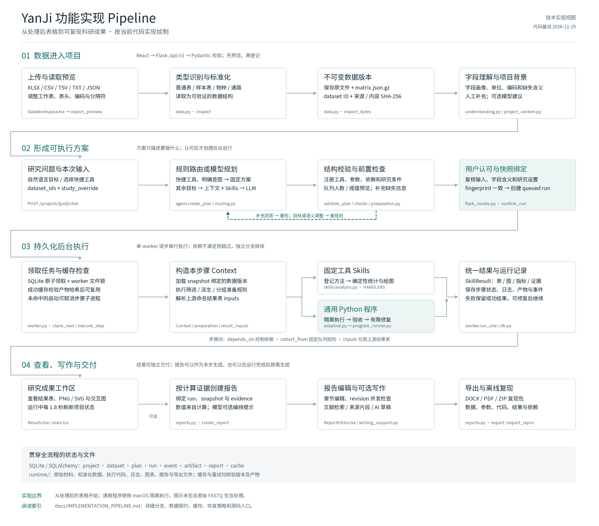

# 研迹 YanJi

面向表格数据的个人科研工作台，将数据整理、研究规划、统计分析、绘图和报告编辑串成一条可追溯的工作流。

研迹从处理后的数据表开始。用户选择本次输入、描述研究问题，核对分析方案后提交后台执行，在同一项目中查看图表、结果表和研究报告。原始材料、分析参数、执行记录与结果证据分别保存，方便回溯与复现。

## 主要功能

- **项目与材料管理**：创建、编辑和删除项目；删除时一并清除文件、分析记录和报告。保留文件及工作表版本，按任务明确选择输入。
- **表格导入与理解**：预览 Excel、CSV、TSV、TXT 和记录型 JSON；调整工作表、表头、编码与分隔符，补充字段单位、编码和背景。
- **研究规划**：支持自然语言问题与快捷工具；在方案中展示步骤、方法、所用字段、分组和纳排条件，缺失信息直接补充。
- **数据准备**：按编号合表、筛选、派生计算、重编码、阈值与分位数分组，保留队列和匹配审计。
- **统计与绘图**：分布、组间比较、相关、偏相关、协变量校正回归、基线表，以及组成、多样性、物种与通路分析；输出结果表、PNG、SVG 和适用的交互图。
- **动态分析程序**：固定工具无法表达的任务，可按确认的方法生成 Python 程序，隔离执行、检查产物并有限修复。
- **后台任务与恢复**：持久化队列、步骤缓存、进度与日志、取消、失败后继续；保留已完成结果。
- **报告与复现**：编辑报告章节、关联计算证据、检索文献与整理写作草稿，导出 DOCX、PDF 和 ZIP 复现包。

## 实现流程



详细流程、执行分支和代码入口见[功能实现 Pipeline](docs/IMPLEMENTATION_PIPELINE.md)。

技术栈：React 19、TypeScript、Vite、ECharts；Flask、Pydantic、SQLAlchemy、SQLite；pandas、NumPy、SciPy、statsmodels、scikit-bio 和 Matplotlib。

## 快速开始

### 1. 准备环境

推荐使用 **Python 3.12、Node.js 22 和 npm**。完整通用程序执行功能当前需要 macOS；其他系统尚需适配隔离执行后端。

```bash
git clone https://github.com/Jaliiina/YanJi.git
cd YanJi
python3.12 -m venv .venv
source .venv/bin/activate
python -m pip install -r requirements.txt
npm --prefix frontend ci
npm --prefix frontend run build
```

### 2. 配置服务

```bash
cp .env.example .env
```

在 `.env` 中填写模型服务的 `api_key`、`base_url` 和 `model`。模型接口采用 OpenAI 兼容协议，用于字段建议、研究规划、程序生成与写作；数值计算由分析方法或隔离程序完成。没有模型连接时仍可使用固定快捷工具。

可选文献服务配置见[文献与写作接口](#文献与写作接口)。不要将 `.env` 中的密钥提交到仓库。

### 3. 启动

```bash
python app.py
```

打开 <http://127.0.0.1:8810>。默认同时启动网页服务与后台 worker，关闭浏览器页面不会中断任务；停止服务请在终端按 `Ctrl+C`。

如需更改端口或独立管理后台任务，在启动进程时设置环境变量：

```bash
YANJI_PORT=8820 python app.py
```

```bash
# 终端一：网页服务
YANJI_EXTERNAL_WORKER=1 python app.py

# 终端二：后台任务
python worker.py
```

`YANJI_RUNTIME` 可指定运行数据目录，默认是项目下的 `runtime/`。这些启动选项通过进程环境变量读取。

## 使用步骤

1. 新建项目，填写名称和研究背景。
2. 添加文件，核对实际预览，调整读取设置后保存。
3. 选择本次输入文件，描述研究问题或选择分析工具。
4. 补充方案需要的信息，核对方法、字段、分组、样本数与排除规则。
5. 认可方案后开始分析，在研究成果中查看进度、日志、图表与结果表。
6. 按需创建并编辑报告，导出文档或复现包。

方案确认会绑定数据版本、字段含义和研究设置。所选输入发生变化时需要重新规划和认可，避免新数据与旧方案混用。

## 数据与分析范围

支持普通表格、样本信息表、MetaPhlAn 分类表、HUMAnN 总通路和物种分层通路，以及明确类型和单位的矩阵。Excel 工作表分别登记；文本支持 UTF-8、GB18030 及常用分隔符。未知结构保留为普通表，不自动解释成物种矩阵，也不默认补零或求和恢复缺失通路总量。

固定方法包括 Mann–Whitney、Kruskal–Wallis、Spearman、偏相关、HC3 校正回归、BH 多重检验校正、Alpha/Beta 多样性与 PERMANOVA 等。各方法对样本独立性、样本量、缺失值和数据类型有明确要求；条件不满足时显示跳过或失败原因，并阻断依赖步骤。

不处理原始 FASTQ、PDF、图片或复杂嵌套 JSON。通用程序路径不意味着任意方法和研究设计都已支持；配对、重复测量及特殊算法需要对应实现。方法定义和限制见[数据与方法](docs/DATA_AND_METHODS.md)及[研究方法说明](docs/BIOLOGY_METHODS.md)。

## 项目结构

```text
YanJi/
├── app.py                  # 网页服务入口，默认同时启动 worker
├── worker.py               # 独立后台任务入口
├── src/yanji/
│   ├── flask_app.py        # Flask 应用与本地请求保护
│   ├── flask_routes.py     # 业务接口
│   ├── contracts.py        # 数据、方案和结果契约
│   ├── data.py             # 数据导入、版本与映射
│   ├── understanding.py    # 字段画像与说明
│   ├── agent.py            # 规划、校验与补充信息
│   ├── preparation.py      # 队列准备与预览
│   ├── result_inputs.py    # 上游结果绑定
│   ├── skills/             # 工具目录、分析方法与绘图
│   ├── adaptive.py         # 通用程序生成、隔离执行与验收
│   ├── worker.py           # 持久化队列、缓存与恢复
│   ├── reports.py          # 报告和导出
│   └── writing_support.py  # 文献检索与写作支持
├── frontend/src/           # 页面、数据工作区、结果和报告编辑器
├── tests/                  # 接口、方法与流程回归
├── scripts/                # 类型契约生成与离线复现
├── assets/fonts/           # 中文字体及其许可证
├── docs/                   # 使用、架构和方法文档
├── requirements.txt        # 运行依赖
└── requirements-dev.txt    # 测试与代码检查依赖
```

`runtime/`、`raw_data/`、本地密钥、依赖目录、缓存和构建产物均不进入版本控制。

## 开发与验证

安装开发依赖：

```bash
python -m pip install -r requirements-dev.txt
```

执行检查：

```bash
python -m ruff check .
python -m ruff format --check .
python -m pytest -q
npm --prefix frontend run build
```

测试默认使用独立临时运行目录和合成数据。依赖本地研究文件的测试在文件缺失时跳过；需要真实系统隔离的集成测试通过 `YANJI_TEST_OS_SANDBOX=1` 显式启用。模型及文献服务接口测试使用替身，不代表部署环境的真实连接已经验证。

前端开发时，在运行 Flask 后另开终端执行：

```bash
npm --prefix frontend run dev
```

Vite 将 `/api` 请求转发至本地 `8810` 端口。修改后端契约后，可重新生成前端类型：

```bash
python scripts/generate_contracts.py /tmp/yanji-contracts.json
cd frontend
npx openapi-typescript /tmp/yanji-contracts.json -o src/generated-api.d.ts
```

仓库包含后端检查和前端构建的 GitHub Actions 工作流。

## 文献与写作接口

在 `.env` 中设置 `literature_url`，按需填写 `literature_api_key`。通用文献服务契约：

- `POST /search`：请求 `{"query":"研究问题","top_k":5}`，响应 `{"items":[{"id":"文献ID","title":"题名","abstract":"摘要","url":"来源链接"}]}`。
- `GET /papers/{id}`：响应 `{"content":"可读取的正文"}`。

使用 ai-localbase 时设置 `literature_kind=localbase` 和 `literature_kb`。检索轨迹、来源片段和内容哈希随记录保存。写作草稿需要用户采用并保存；引用 ID 检查不能替代正文与来源核对。

## 数据保存与结果复现

项目状态保存在 SQLite，原文件、标准化数据、结果、报告和日志保存在 `runtime/`。上传新文件和重新执行不会覆盖历史报告。失败或中断的任务可以在核对输入版本后继续，已完成的有效步骤会保留。

ZIP 复现包包含所选数据、参数、执行代码、结果和依赖；解压并安装相应依赖后，运行 `python reproduce.py`。复现计算不需要模型密钥；通用程序的离线复现仍需要兼容的隔离执行环境。

模型服务接收研究目标、字段画像、用户说明和必要结果证据，不发送完整丰度矩阵。用户输入的说明也可能用于相关模型请求，应按研究数据的实际使用范围填写。

## 文档导航

- [使用指南](docs/USER_GUIDE.md)
- [功能实现 Pipeline 与源码索引](docs/IMPLEMENTATION_PIPELINE.md)
- [系统架构](docs/ARCHITECTURE.md)
- [项目与分析流程](docs/PRODUCT_FLOW.md)
- [数据与方法](docs/DATA_AND_METHODS.md)
- [分析工具目录](docs/SKILLS.md)
- [动态分析执行](docs/DYNAMIC_ANALYSIS.md)
- [研究目标与执行恢复](docs/EXECUTION_RECOVERY.md)
- [研究方法说明](docs/BIOLOGY_METHODS.md)

## 维护与反馈

问题反馈请提交至 [Issues](https://github.com/Jaliiina/YanJi/issues)，附上复现步骤和经过脱敏的日志；请勿上传密钥或真实研究数据。

第三方字体的授权说明见 [OFL.txt](assets/fonts/OFL.txt)。
