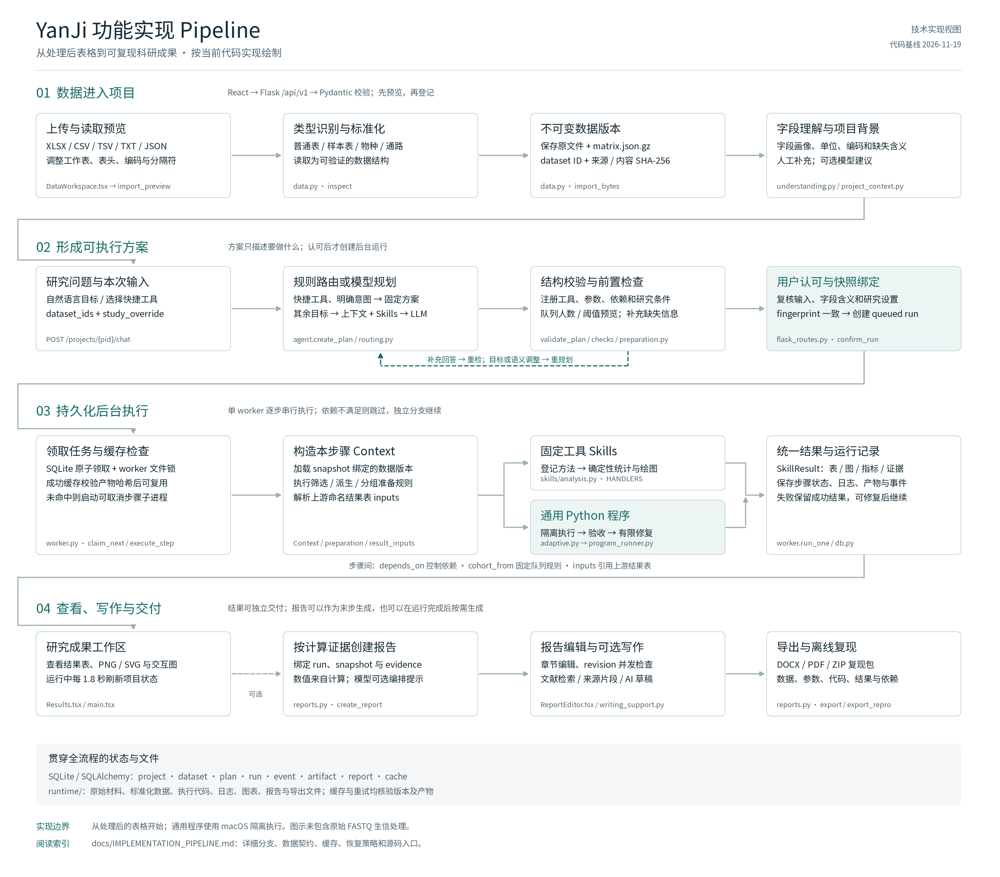
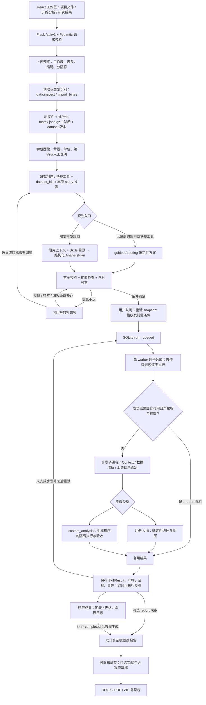
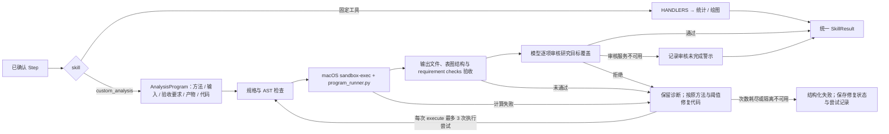

# YanJi 功能实现 Pipeline

依据 2026-11-19 工作区代码整理；描述当前实现，不将设计文档中的历史规划视作已经实现的功能。

[矢量图 SVG](assets/implementation-pipeline.svg) · [高清图 PNG](assets/implementation-pipeline.png)

## 1. 从用户操作到后台计算

## 2. 两条执行路径如何汇合

固定工具的入口是 `skills/analysis.py::execute`，由 `HANDLERS` 分发到登记方法；通用程序的入口是 `adaptive.py::execute`。二者最终都返回 `SkillResult`，供 worker、结果页和报告共同使用。

通用程序通常在方案生成阶段就补齐代码并展示给用户；执行阶段发生错误时才进行有限修复。修复约束要求保留已确认的方法、输出、阈值和研究问题。生成程序的隔离计算每次限时 90 秒，worker 的整个步骤另有 600 秒上限。隔离环境不可用时明确失败。

输出结构检查和模型审核提供过程校验，不等于统计结论已经获得专家验证。模型审核服务不可用时，已经通过程序验收的结果可以保留，但会附带警示。

## 3. 技术人员需要掌握的几个契约

- **输入绑定**：项目文件目录由 `material_ids` 管理，本次任务用 `dataset_ids` 选择输入。`snapshot` 固定 dataset ID、字段含义和 study 设置，确认时比较 `fingerprint`，防止按过期方案启动。
- **步骤依赖**：`Step.depends_on` 表达依赖；当前 worker 按方案顺序串行执行，不是并行 DAG 调度。依赖未成功的步骤标记为 `skipped`；其他独立分支继续。
- **队列准备**：`prepare_cohort` 描述筛选、派生、重编码、阈值或分位数分组。`cohort_from` 经 `compile_cohorts` 编译为下游同一套准备规则，`Context` 再按规则构造数据视图，并非直接修改原数据或复用可变全局分组。
- **结果传递**：`Step.inputs` 以 `{step_id, output}` 绑定上游命名结果表；`result_inputs.resolve/read_tables` 解析并校验来源。例如合表 → 校正回归 → 效应图，图形步骤消费真实结果表。
- **统一输出**：`SkillResult` 包含 `status / summary / method / metrics / warnings / evidence / artifacts`；worker 加入 `step_id`，并记录失败、缓存复用和运行事件。
- **缓存**：键包含数据版本、来源哈希、整理记录、字段含义、study、Skill 版本、参数、program、上游结果与准备器版本；命中后仍核验产物文件及 SHA-256。报告步骤不复用该缓存。
- **失败恢复**：失败和不适用分别记录为 `failed`、`skipped`；失败依赖被阻断。重试核对原输入快照及成功产物，保留依赖完整的成功步骤，再入队继续。服务重启将运行标为 `interrupted`，等待用户继续。
- **运行观测**：前端在存在 queued/running 任务时每 1.8 秒刷新项目状态。后端另提供事件查询、步骤日志和 SSE 接口；当前主工作区没有用 SSE 驱动状态刷新。
- **存储**：SQLAlchemy 的 `records` 表按 kind 保存 project/dataset/plan/run/event/artifact/report/cache 等版本化 JSON；SQLite 开启 WAL。原始文件、标准化数据、执行代码、日志、图表及导出文件保存在 `runtime/` 文件目录。
- **报告与文献**：报告绑定 run 和 snapshot；编辑使用 revision 检查。文献检索、来源片段与 AI 写作草稿是可选支路；草稿采用后才进入正文。按需报告及写作接口当前同步处理，数值分析由后台 worker 执行。

## 4. 代码阅读入口

路径相对 `YanJi/`：

1. **网页及启动**：`app.py`、`src/yanji/flask_app.py`、`frontend/src/main.tsx`。默认由 `app.py` 同时启动 Flask 与 worker；`YANJI_EXTERNAL_WORKER=1` 支持独立 worker。
2. **HTTP 边界**：`src/yanji/flask_routes.py`。先看 `import_preview`、`upload_dataset`、`chat`、`confirm_run`、`retry_run`、`report_from_run`。
3. **数据与语义**：`src/yanji/data.py` 的 `inspect/import_bytes/selected_inputs`；`understanding.py` 的 `describe/save`；`project_context.py` 组织规划上下文。
4. **规划与补充**：`src/yanji/agent.py` 的 `create_plan/validate_plan/checks/clarify`，配合 `routing.py`、`clarify.py`、`contracts.py` 和 `skills/registry.py`。
5. **数据准备与结果绑定**：`src/yanji/preparation.py`、`result_inputs.py`、`skills/context.py`。
6. **调度与执行**：`src/yanji/worker.py` 的 `claim_next/run_one/execute_step/recover` → `execute.py` → `skills/analysis.py` 或 `adaptive.py/program_runner.py`。
7. **结果与报告**：`frontend/src/components/Results.tsx`、`ReportEditor.tsx`；后端 `reports.py`、`writing_support.py`。
8. **持久化与迁移**：`src/yanji/db.py`、`migrations.py`。

## 5. 实现边界

当前是本地 Flask + React 工作台，后台为 SQLite 持久化队列与单消费者。输入从处理后的表格开始，不包含原始 FASTQ 生信处理流水线。模型参与语义建议、结构化规划、通用程序生成与修复、结果审核和写作；实际数值由登记方法或隔离 Python 程序计算。固定工具入口可在没有模型配置时使用。

本次仅阅读代码并制作说明图，没有修改业务逻辑，也没有通过真实模型、真实文献服务或科研数据验证分析结论。
